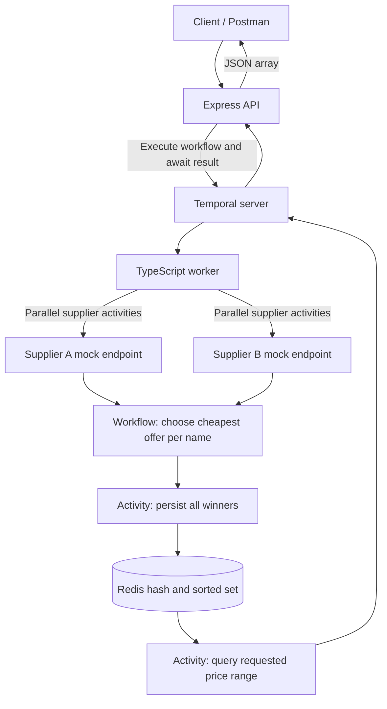

# Hotel Offer Orchestrator — implementation plan

## Goal and scope

Build an Express API in TypeScript that uses Temporal to fetch two mock suppliers in parallel, selects the cheapest offer for each hotel name, stores the complete deduplicated result in Redis, and filters prices using Redis queries. Deliver source code, a Docker image, Docker Compose configuration, setup and deployment documentation, automated checks, and a Postman collection.

The current workspace has no application source. Existing environment files and unrelated verification artifacts should be preserved. This document plans the work; implementation and deployment are subsequent steps.

## Proposed decisions

- Require `city`; trim and lowercase it before supplier lookup. A valid city without fixtures returns HTTP 200 with `[]`.
- Treat hotel identity as the trimmed, case-insensitive hotel name within the requested city. Preserve the winning supplier's display name. Do not attempt fuzzy matching.
- Select the lowest listed price. Commission is returned as metadata and does not affect selection.
- If prices tie, choose Supplier A consistently, regardless of activity completion order.
- Accept optional finite, nonnegative numeric `minPrice` and `maxPrice`. Both bounds are inclusive; either bound can be omitted. Reject empty, repeated, malformed, or inverted parameters with HTTP 400.
- Return offers ordered by ascending price, with normalized name as the secondary order.
- Fetch both suppliers on every request in the initial version. Redis is the result store and filtering engine; a cache-hit policy is outside the required scope.
- Fail the request if either supplier remains unavailable after bounded retries. Partial results would weaken the cheapest-offer guarantee.
- Expire Redis snapshots after a configurable interval, initially 10 minutes. Use a unique snapshot for each workflow execution to prevent simultaneous requests from replacing each other's data.

## Architecture



Run the API and worker as separate processes from the same application image. The worker calls the supplier routes over HTTP using a configured internal API base URL. This keeps the mocked integrations realistic and makes supplier failure tests possible.

Temporal workflows contain deterministic comparison logic. HTTP requests, Redis commands, and other external side effects belong in activities. Use a shared task queue and the Temporal client from the Express process. Generate a unique workflow ID for each API request, execute the workflow, and await its result.

## Endpoints and contracts

- `GET /supplierA/hotels?city=delhi`: static Supplier A fixtures, including `hotelId`, `name`, `price`, `city`, and `commissionPct`.
- `GET /supplierB/hotels?city=delhi`: equivalent Supplier B fixtures with overlapping names and different prices. Without a city, the supplier endpoints can return all their fixtures.
- `GET /api/hotels?city=delhi`: all deduplicated winners.
- `GET /api/hotels?city=delhi&minPrice=5000&maxPrice=6000`: winners within the inclusive range, selected in Redis.
- `GET /health`: supplier, Redis, and Temporal server connectivity with a dependency status for each. Return 200 when all checks pass and 503 when any fails. Document that connectivity alone does not prove a worker is processing tasks.

Use fixtures that reproduce the requested example: Supplier B wins Holtin at 5340, and Supplier A wins Radison at 5900. Include at least one hotel unique to each supplier, a tied-price hotel, another city, and a city with no data.

Successful hotel responses contain only `name`, `price`, `supplier`, and `commissionPct`. Validation and dependency failures use a consistent error object with a stable error code and request ID. Never return stack traces to clients.

## Workflow and Redis design

1. Validate the request in Express and pass normalized city and optional bounds to the workflow.
2. Run `fetchSupplierA` and `fetchSupplierB` concurrently using `Promise.all`. Validate each supplier payload in its activity before returning it.
3. Build a map keyed by normalized hotel name. Replace an existing entry only when the incoming price is lower; process A before B to make ties deterministic.
4. Call `saveOffers` to atomically persist every winner, before any price filtering.
5. Call `queryOffers` with the snapshot identifier and bounds. Return the activity's result through the workflow to Express.

Redis keys for one workflow execution:

```text
hotels:{snapshotId}:offers  HASH  normalized hotel name -> winning offer JSON
hotels:{snapshotId}:prices ZSET  normalized hotel name -> score equal to price
hotels:{snapshotId}:meta   HASH  city, count, creation time
```

Write all three structures and their expiry in one Redis transaction. Keep metadata even for an empty result. The hash-tag braces also keep the snapshot keys together if Redis Cluster is introduced later.

Filter with `ZRANGE ... BYSCORE` using the provided bounds, `-inf` for an omitted minimum, and `+inf` for an omitted maximum. Retrieve matching JSON records with `HMGET` in the returned order. Do not filter an array in JavaScript. Check snapshot metadata so an expired snapshot is treated as an error rather than an empty hotel list.

Because every request gets its own snapshot, concurrent requests for the same city cannot read another request's result. This prioritizes correct request behavior over shared caching in the first version.

## Errors, time limits, and logging

- Give supplier HTTP requests a short timeout, initially 3 seconds.
- Use bounded Temporal activity retries, initially three attempts with backoff and a 10-second start-to-close timeout. Retry timeouts, transport failures, and appropriate server errors; treat invalid payloads and non-retryable client errors as terminal.
- Apply an overall workflow execution timeout, initially 45 seconds, and configure HTTP/deployment proxy timeouts to allow a response beyond that limit.
- Return HTTP 502 for terminal supplier failures, 503 for unavailable infrastructure, and 504 for workflow execution timeout. Map Temporal failure causes deliberately rather than passing SDK errors through to Express.
- Log request ID, workflow ID, city, supplier, duration, offer counts, retries, and terminal errors. Use Temporal's workflow logger for replay-safe workflow logs and structured activity/API logs.
- Support graceful shutdown for API connections, the worker, and Redis clients.
- Add a mock supplier failure flag for optional Postman failure tests. Default it to disabled and document how to restart the API with the flag enabled.

## Suggested source layout

```text
src/
  api/             Express app, routes, validation, error handling
  mocks/           Supplier fixtures and mock routes
  temporal/        Client setup, worker entrypoint, workflow
  activities/      Supplier HTTP, Redis persistence and queries
  domain/          Types and deterministic offer selection
  config/          Validated environment configuration
tests/             Unit, Redis integration, workflow/API checks
postman/           Collection and local environment JSON
Dockerfile
compose.yaml
.env.example
README.md
```

## Implementation order

1. **Foundation and contracts:** initialize Node/TypeScript, package scripts, validation, configuration, shared types, mock fixtures, and Express supplier routes. Confirm that fixtures cover overlapping and unique hotels.
2. **Selection and Redis:** implement name normalization and deterministic cheapest-offer selection, snapshot transactions, expiry, and score-based filtering. Verify against a real Redis instance.
3. **Temporal orchestration:** implement the parallel supplier activities, workflow, Redis activities, worker, and API client integration. Confirm the workflow actually executes through Temporal and returns Redis-selected results.
4. **Resilience and health:** add bounded retries, error translation, dependency health, supplier failure simulation, logging, and graceful shutdown.
5. **Containers and verification:** build a multi-stage application Docker image and Compose services for API, worker, Redis, and Temporal. Configure internal hostnames, readiness checks, and persistent Temporal storage. Pin supported image versions during implementation.
6. **Submission and deployment:** add Postman assertions and README instructions, run the full stack from a clean start, and document or carry out deployment to the agreed hosting target. Publish the intended project files to GitHub when the repository and access are available.

## Validation and acceptance criteria

- Overlapping names select the cheaper offer and preserve its supplier and commission.
- Unique hotels remain in the result; duplicate names within a supplier also collapse to the cheapest offer.
- Equal prices consistently choose Supplier A; casing and surrounding whitespace do not create duplicates.
- Empty-city results are `[]`; missing/invalid city and invalid price ranges return 400.
- Minimum-only, maximum-only, exact-price, inclusive-boundary, zero-price, and no-match filters behave correctly.
- Redis contains the complete winner set even when the requested range excludes some winners. Filtering executes a Redis score query.
- Concurrent requests use independent snapshots, and expiry does not masquerade as an empty result.
- Workflow tests demonstrate concurrent supplier activity execution and the expected terminal behavior after a supplier fails. Redis integration tests exercise transactions and actual range queries rather than mocking Redis semantics.
- API end-to-end checks execute through a running Temporal worker. A clean `docker compose up --build` produces a usable API and visible workflows in the Temporal UI.
- Postman includes overlap, unknown city, bounded and one-sided ranges, invalid ranges, mock routes, health, and optional supplier-down scenarios with status/body assertions.
- Run TypeScript checking, linting, relevant tests, and a containerized smoke check before submission. CI should execute these appropriate checks.

## Deployment boundary

For coursework or a demo, deploy the Compose stack on a single VM and expose the API through an HTTPS reverse proxy. Keep Redis and Temporal networking private. A local Temporal development server is suitable for local validation and a clearly labeled demo; durable production deployment requires a supported Temporal server/database setup or Temporal Cloud.

The hosting provider, domain, GitHub repository, and available deployment credentials are not specified. They are needed for actual remote deployment, but do not prevent implementing and validating the complete stack locally.
