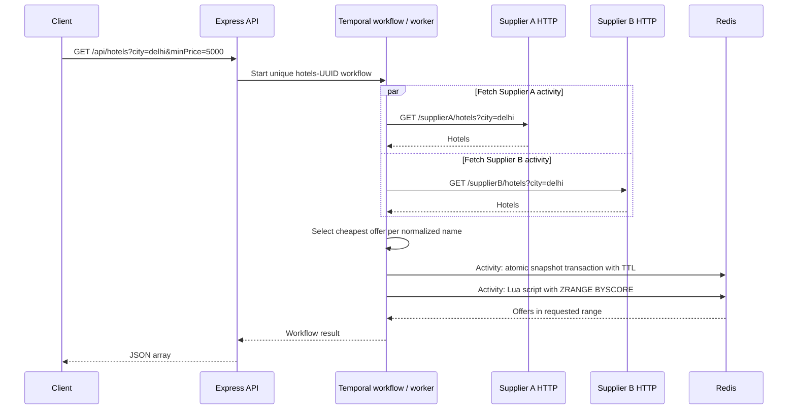

# tripathe — Hotel Offer Orchestrator

An Express API in TypeScript that uses Temporal to call two mock hotel suppliers in parallel, selects the cheapest offer for each hotel name, stores every winner in Redis, and applies inclusive price filters inside Redis.

## Start with Docker Compose

Prerequisites: a running Docker Engine/Desktop, Docker Compose 2.24+ (or v5), and access to npm and container registries for the first build.

```sh
cp .env.hotel.example .env.hotel
docker compose --env-file .env.hotel up --build --detach --wait
curl 'http://localhost:3000/health'
curl 'http://localhost:3000/api/hotels?city=delhi'
curl 'http://localhost:3000/api/hotels?city=delhi&minPrice=5000&maxPrice=6000'
```

The API is at `http://localhost:3000`. Temporal's UI is at `http://localhost:8233`; inspect a `hotels-…` workflow to see both supplier activities, persistence, price queries, and retries. Responses include `x-request-id` and, once a workflow starts, `x-workflow-id` for correlation.

The bounded example returns:

```json
[
  { "name": "Holtin", "price": 5340, "supplier": "Supplier B", "commissionPct": 20 },
  { "name": "Radison", "price": 5900, "supplier": "Supplier A", "commissionPct": 13 }
]
```

The full Delhi list contains Budget Nest (2800), City Inn (4200), Holtin (5340), Radison (5900), and Grand Palace (7500), in price order. Mumbai and Bengaluru also have fixtures. An unknown city, such as `atlantis`, returns `[]`.

The workspace contained environment files from an unrelated project. They are preserved. This service uses `.env.hotel`; Node processes do not automatically load `.env`. Compose overrides internal API, Redis, and Temporal addresses with container hostnames.

## Endpoints and rules

- `GET /api/hotels?city=delhi`: complete deduplicated winner list.
- `GET /api/hotels?city=delhi&minPrice=5000&maxPrice=6000`: inclusive range.
- `GET /api/hotels?city=delhi&minPrice=5900`: minimum only.
- `GET /api/hotels?city=delhi&maxPrice=4200`: maximum only.
- `GET /supplierA/hotels` and `GET /supplierB/hotels`: raw static supplier arrays; an optional `city` parameter filters each supplier's fixtures.
- `GET /health`: actual supplier HTTP checks, Redis PING, and Temporal namespace connectivity. Returns 200 when all dependencies are up, otherwise 503 with each dependency's status and latency.
- `GET /live`: HTTP process liveness, used by Compose independently of dependency health.

`city` is required for aggregation, trimmed, and case-insensitive. Names are deduplicated by trimmed, case-insensitive equality within that city; there is no fuzzy matching. Equal prices consistently choose Supplier A. The response preserves the selected offer's display name and commission. Commission does not change price selection.

Prices are fixture amounts in INR, without conversion or commission adjustment. Bounds accept nonnegative decimal amounts with up to two decimal places, including zero. Missing bounds are unbounded. Malformed, empty, repeated, negative, excessively large, or inverted parameters return HTTP 400. Successful lists are ordered by price, then normalized name. Empty results use HTTP 200.

Failures use a consistent object:

```json
{
  "error": {
    "code": "INVALID_QUERY",
    "message": "minPrice must be less than or equal to maxPrice",
    "requestId": "…"
  }
}
```

Supplier failures return 502; unavailable Redis or Temporal returns 503; workflow timeouts return 504. Unexpected errors return a sanitized 500. If either supplier remains unavailable after retries, the request fails because a partial response cannot guarantee the cheapest offer.

## Temporal and Redis design



The API and worker are separate processes from the same image. Hotel aggregation starts and awaits an actual Temporal workflow. Only deterministic comparison runs in the workflow; HTTP requests and Redis commands run in activities. Health checks call suppliers directly without creating workflows.

Each execution has three Redis keys:

```text
hotels:{hotels-UUID}:offers  HASH: normalized name -> complete winning offer JSON
hotels:{hotels-UUID}:prices ZSET: normalized name -> price score
hotels:{hotels-UUID}:meta   HASH: requested city and winner count
```

All winners are stored before filtering. A Redis transaction replaces the snapshot and sets its expiry atomically, making write retries idempotent. A Redis Lua script checks metadata, executes `ZRANGE prices min max BYSCORE`, and retrieves the associated JSON within the same atomic operation. Price filtering does not happen in JavaScript. The atomic read avoids expiry occurring between separate index and hash reads.

Each request has its own snapshot to isolate concurrent requests. There is no cache-hit shortcut: both suppliers are queried on every request. Snapshots expire after 600 seconds by default. Metadata records empty results; a missing snapshot is an error rather than a misleading empty list.

To inspect a result, replace `hotels-UUID` with the response's `x-workflow-id`:

```sh
docker compose exec redis redis-cli HGETALL 'hotels:{hotels-UUID}:offers'
docker compose exec redis redis-cli ZRANGE 'hotels:{hotels-UUID}:prices' 5000 6000 BYSCORE WITHSCORES
docker compose exec redis redis-cli TTL 'hotels:{hotels-UUID}:meta'
```

## Timeouts, retries, and logs

Supplier HTTP calls time out after 3 seconds by default. Supplier activities retry transient errors up to three attempts with backoff, within a 25-second schedule-to-close limit. Invalid payloads and non-transient client errors do not retry. Redis activities also have bounded retries. Each workflow has a 45-second execution limit; the API socket allows 60 seconds. Configure reverse proxies with at least a 60-second upstream read timeout.

API logs are structured JSON with request ID, workflow ID, HTTP status, and duration. Activities log suppliers, cities, attempts, counts, and durations. Workflows use Temporal's replay-aware logger. API and worker support graceful shutdown.

```sh
docker compose logs --follow api worker
docker compose ps
docker compose down
```

Named volumes preserve Redis data and Temporal history across normal restarts. `docker compose down --volumes` deletes this stack's stored data and history; use it only to intentionally reset the demo.

## Local Node development

Prerequisite: Node.js 22.13+ (24 LTS recommended).

```sh
npm install
cp .env.hotel.example .env.hotel
docker compose --env-file .env.hotel up --detach --wait redis temporal
```

In two terminals:

```sh
# Terminal 1
node --env-file=.env.hotel --import tsx src/api/server.ts

# Terminal 2
node --env-file=.env.hotel --import tsx src/temporal/worker.ts
```

`npm run dev:api` and `npm run dev:worker` provide watch mode using defaults or variables exported by your shell. For compiled processes, run `npm run build`, then `node --env-file=.env.hotel dist/api/server.js` and `node --env-file=.env.hotel dist/temporal/worker.js`.

Runtime dependencies are pinned in the manifest. Run `npm install` on a network-enabled machine to generate `package-lock.json`, commit it, and use `npm ci` for subsequent installs. The implementation environment could not reach npm for Temporal/ioredis, so a complete generated lockfile is not included; none has been fabricated.

## Tests and Postman

```sh
npm run check
docker compose up --detach --wait redis
npm run test:integration
# With the complete API/worker/Redis/Temporal stack running:
npm run smoke
```

Unit tests cover cheapest selection, duplicate and tied names, price validation, configuration, supplier payloads and HTTP failures, Express contracts, health, and error mapping. Integration tests use real Redis and a real local Temporal test server. A supplier-response barrier verifies parallel activities: sequential calls would time out. The workflow test asserts that Redis stores all five Delhi winners even when only two are returned, and that a failed supplier is attempted three times.

The Temporal testing SDK downloads a CLI test server on its first integration run, requiring network access. The smoke script tests the running API through Temporal and verifies real Redis-filtered responses. GitHub Actions runs checks, integration tests, a Compose build, and the smoke script.

Import `postman/hotel-offers.postman_collection.json` and `postman/local.postman_environment.json` into Postman. Select **Hotel Offers Local** and run the **API checks** folder. Requests assert exact winners, response fields, sorting, bounds, unknown-city behavior, invalid queries, suppliers, and health. Set the Postman request timeout to at least 60000 ms.

To simulate Supplier B being down, change `MOCK_SUPPLIER_B_DOWN=true` in `.env.hotel`, then recreate the API:

```sh
docker compose --env-file .env.hotel up --detach --force-recreate api
curl 'http://localhost:3000/health'
curl 'http://localhost:3000/api/hotels?city=delhi'
```

Health should return 503 and report Supplier B down. Hotel aggregation should return 502 after retries. In Postman, set `runFailureChecks=true` and run only the **Supplier failure (optional)** folder. Restore the flag to false and recreate the API before running normal tests.

## Configuration

See `.env.hotel.example` for defaults. `HOTEL_PORT` controls the Node listening port; `HOTEL_API_PORT` controls the Compose host port. `HOTEL_API_BIND` defaults to loopback. API and worker share `TEMPORAL_ADDRESS`, `TEMPORAL_NAMESPACE`, and `TEMPORAL_TASK_QUEUE`. `REDIS_URL`, `SUPPLIER_BASE_URL`, `SUPPLIER_TIMEOUT_MS`, and `SNAPSHOT_TTL_SECONDS` control integrations. Both mock-down flags default to false.

The local Temporal server creates the `default` namespace automatically. Create a custom namespace before starting the application if you configure one:

```sh
docker compose exec temporal temporal operator namespace create --namespace your-namespace
```

Health verifies dependency connectivity; it does not prove that a worker is polling. `npm run smoke` verifies worker execution as well.

## Deployment and submission

For a single-VM coursework demo, copy or clone the project onto a Docker host and run the same Compose command. The default API binding is loopback, suitable for a reverse proxy running on that host. Configure HTTPS, proxy to `127.0.0.1:3000`, and use at least a 60-second upstream timeout. Redis, Temporal gRPC, and the Temporal UI stay private; use an SSH tunnel for remote UI access. For intentional direct LAN demo access, set `HOTEL_API_BIND` to the desired host interface.

The Compose Temporal service is a persisted development server for local work and labeled demos. Production needs a supported Temporal service/database deployment or Temporal Cloud, authenticated connections, TLS, and backups. This application currently configures local unauthenticated connections; Temporal Cloud TLS/API-key configuration would need to be added to both client and worker before using it.

The deployment target is `16.179.88.241` and the repository is [Webrookie0/tripathe](https://github.com/Webrookie0/tripathe). See [the EC2 guide](deploy/EC2.md) for SSH rules, key selection, port-80 deployment, and Git publication commands. This workspace blocks outbound SSH and writes to its protected `.git` directory; no live deployment or GitHub push has been verified. Existing `.env`/`.env.hotel`, verification artifacts, dependencies, and build outputs are excluded by `.gitignore`.

Submission artifacts: `src/`, `Dockerfile`, `compose.yaml`, `compose.ec2.yaml`, `deploy/`, this README, `tests/`, `.github/workflows/ci.yml`, `.env.hotel.example`, and the Postman collection/environment.

References: [Temporal TypeScript SDK](https://docs.temporal.io/develop/typescript), [Temporal CLI](https://github.com/temporalio/cli), and [Redis ZRANGE](https://redis.io/docs/latest/commands/zrange/).
