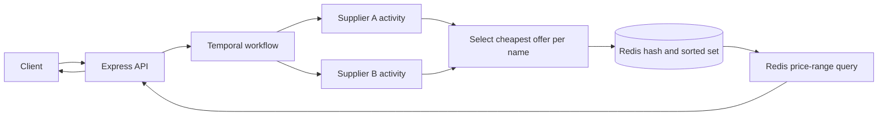

# tripathe — Hotel Offer Orchestrator

A Node.js/TypeScript and Express API that aggregates two mock hotel suppliers, selects the cheapest offer for each hotel name, and filters the resulting list by price. Temporal orchestrates the work, and Redis stores the complete deduplicated results and applies price-range queries.

**Deployed API base URL:** `http://16.179.88.241`  
**GitHub repository:** [Webrookie0/tripathe](https://github.com/Webrookie0/tripathe)

## Try the deployed API

- [Hotels in Delhi](http://16.179.88.241/api/hotels?city=delhi)
- [Delhi hotels between 5000 and 6000](http://16.179.88.241/api/hotels?city=delhi&minPrice=5000&maxPrice=6000)
- [Mumbai hotels](http://16.179.88.241/api/hotels?city=mumbai)
- [City with no results](http://16.179.88.241/api/hotels?city=atlantis)
- [Dependency health](http://16.179.88.241/health)
- [Supplier A mock API](http://16.179.88.241/supplierA/hotels?city=delhi)
- [Supplier B mock API](http://16.179.88.241/supplierB/hotels?city=delhi)

```sh
curl 'http://16.179.88.241/api/hotels?city=delhi'
curl 'http://16.179.88.241/api/hotels?city=delhi&minPrice=5000&maxPrice=6000'
curl 'http://16.179.88.241/health'
```

The filtered Delhi request returns:

```json
[
  {
    "name": "Holtin",
    "price": 5340,
    "supplier": "Supplier B",
    "commissionPct": 20
  },
  {
    "name": "Radison",
    "price": 5900,
    "supplier": "Supplier A",
    "commissionPct": 13
  }
]
```

The full Delhi result includes Budget Nest (2800), City Inn (4200), Holtin (5340), Radison (5900), and Grand Palace (7500). Fixtures also cover Mumbai and Bengaluru. Unknown cities return `[]`.

Supplier data is deliberately hardcoded, as required by the assignment's mock supplier API specification. The activities fetch this data over HTTP from the two supplier endpoints.

## Approach

Each hotel request starts a Temporal workflow. Two activities fetch Supplier A and Supplier B concurrently. The workflow normalizes hotel names and uses a map to keep the cheapest offer for each name, preserving the winning supplier and commission. It then calls an activity to store the complete winner list in Redis as a hash and a sorted set scored by price. A Redis Lua script applies the optional inclusive price bounds with `ZRANGE ... BYSCORE` and returns matching offers atomically. Each request has a separate snapshot with a TTL, preventing concurrent requests from overwriting each other. Docker Compose runs the API, worker, Redis, and Temporal on AWS EC2, with Nginx exposing the API on port 80.



HTTP and Redis side effects run in activities. The workflow performs deterministic comparison logic. Express waits for the workflow result before returning the JSON response.

## Endpoints and behavior

- `GET /api/hotels?city=delhi` — all deduplicated winning offers.
- `GET /api/hotels?city=delhi&minPrice=5000&maxPrice=6000` — inclusive range.
- `GET /api/hotels?city=delhi&minPrice=5900` — minimum price only.
- `GET /api/hotels?city=delhi&maxPrice=4200` — maximum price only.
- `GET /supplierA/hotels` and `GET /supplierB/hotels` — raw supplier fixtures; optional `city` filtering.
- `GET /health` — health of both supplier endpoints, Redis, and Temporal connectivity.
- `GET /live` — HTTP process liveness.

City and hotel names are trimmed and compared case-insensitively. Equal prices consistently choose Supplier A. Commission is returned as metadata and does not affect price selection. Results are ordered by ascending price, then normalized name.

Prices are fixture amounts in INR. Bounds accept nonnegative decimals with up to two decimal places, including zero. City is required for aggregation. Invalid, empty, repeated, negative, or inverted query parameters return HTTP 400. Unknown cities and ranges with no matches return HTTP 200 with `[]`.

Supplier activities use HTTP timeouts and bounded retries for transient failures. If either supplier remains unavailable, aggregation returns 502 rather than claiming a cheapest price from incomplete data. Infrastructure errors return 503, workflow timeouts return 504, and unexpected errors return a sanitized 500. Errors include a stable code, message, and request ID.

API and activity logs include correlation IDs, durations, supplier names, attempts, and offer counts. Workflows use Temporal's replay-aware logger. Responses include `x-request-id` and, once a workflow starts, `x-workflow-id`.

## Redis storage and filtering

Each workflow uses its own snapshot:

```text
hotels:{hotels-UUID}:offers  HASH: normalized name -> winning offer JSON
hotels:{hotels-UUID}:prices ZSET: normalized name -> price score
hotels:{hotels-UUID}:meta   HASH: city and winner count
```

A transaction saves **all winners before filtering**, replaces any previous data for a retried write, and sets the snapshot TTL. The default TTL is 600 seconds.

The read activity executes a Lua script inside Redis. The script checks snapshot integrity, queries the sorted set with `ZRANGE ... BYSCORE`, and retrieves the matching JSON records atomically. Filtering is performed in Redis. Expired or incomplete snapshots produce an error rather than a misleading empty list.

## Postman

Import:

- [Postman collection](postman/hotel-offers.postman_collection.json)
- [Deployed EC2 environment](postman/deployed.postman_environment.json)

Select **Hotel Offers EC2** and run the **API checks** folder. The environment sets `baseUrl` to `http://16.179.88.241`. Set the request timeout to at least 60000 ms.

The collection contains assertions for overlapping hotels, winning prices and commissions, unknown cities, inclusive and one-sided ranges, invalid inputs, supplier endpoints, and health. The **Supplier failure (optional)** folder is intended for a controlled failure simulation; it is skipped unless `runFailureChecks=true`.

For local testing, import [the local environment](postman/local.postman_environment.json) and select **Hotel Offers Local**.

## Run locally with Docker Compose

Prerequisites: a running Docker Engine/Desktop, Docker Compose 2.24+ or v5, and registry access for the first build.

```sh
git clone https://github.com/Webrookie0/tripathe.git
cd tripathe
cp .env.hotel.example .env.hotel
docker compose --env-file .env.hotel up --build --detach --wait
curl 'http://localhost:3000/api/hotels?city=delhi'
```

Local API: `http://localhost:3000`. Local Temporal UI: `http://localhost:8233`. Inspect `hotels-…` executions in the UI to see supplier activities, Redis persistence, queries, and retries.

The API and worker run as separate processes from the same image. Compose provides Redis and a persisted Temporal development server. This service uses `.env.hotel`; Compose supplies internal service hostnames.

```sh
docker compose logs --follow api worker
docker compose ps
docker compose down
```

Named volumes preserve data across normal restarts. `docker compose down --volumes` intentionally deletes the local stack's data and workflow history.

## Run with local Node.js

Prerequisite: Node.js 22.13+; Node.js 24 LTS is recommended.

```sh
npm install
cp .env.hotel.example .env.hotel
docker compose --env-file .env.hotel up --detach --wait redis temporal
```

Run the following commands in separate terminals:

```sh
node --env-file=.env.hotel --import tsx src/api/server.ts
node --env-file=.env.hotel --import tsx src/temporal/worker.ts
```

Alternatively, use `npm run dev:api` and `npm run dev:worker` for watch mode. Run `npm run build` to produce the compiled application in `dist/`.

## Verification

```sh
npm run check
# Requires a running Redis instance; the Temporal SDK downloads its test server.
npm run test:integration
# Against the deployed API:
HOTEL_API_URL=http://16.179.88.241 npm run smoke
```

Unit tests cover offer selection, validation, supplier-client behavior, API contracts, health, and error mapping. Integration tests exercise real Redis and Temporal. A supplier-response barrier verifies parallel calls, and tests check that Redis retains the complete winner set even when the response is filtered.

GitHub Actions runs type checking, linting, tests, the application build, Compose checks, and a running-stack smoke test. See [VERIFICATION.md](VERIFICATION.md) for the checks actually performed and any remaining verification limits.

## EC2 deployment

The EC2 configuration adds Nginx on port 80. API port 3000, Redis, Temporal gRPC, and the Temporal UI remain bound to loopback on the host. See [the EC2 deployment guide](deploy/EC2.md) for Docker installation, SSH access, and setup.

From a local checkout with SSH access and Docker installed on EC2:

```sh
EC2_HOST=16.179.88.241 EC2_USER=ubuntu \
EC2_SSH_KEY="$HOME/Downloads/triphoria.pem" \
bash scripts/deploy-ec2.sh
```

Use the key pair associated with your instance. The script uploads the application, preserves existing configuration, builds and starts the stack, then checks health and the example filtered response.

The coursework demo uses HTTP and the Temporal development server. HTTPS requires certificate and proxy configuration; a production Temporal deployment requires a supported server/database setup or Temporal Cloud with authentication and TLS.

## Configuration and failure simulation

Defaults are listed in [.env.hotel.example](.env.hotel.example). Important settings include `TEMPORAL_ADDRESS`, `TEMPORAL_NAMESPACE`, `TEMPORAL_TASK_QUEUE`, `REDIS_URL`, `SUPPLIER_BASE_URL`, `SUPPLIER_TIMEOUT_MS`, and `SNAPSHOT_TTL_SECONDS`. API and worker must use the same Temporal namespace and task queue.

To simulate Supplier B being down locally, set `MOCK_SUPPLIER_B_DOWN=true` in `.env.hotel`, then recreate the API:

```sh
docker compose --env-file .env.hotel up --detach --force-recreate api
```

Health should report Supplier B down with HTTP 503; hotel aggregation should return 502 after retries. Restore the flag to false and recreate the API before running normal checks.
